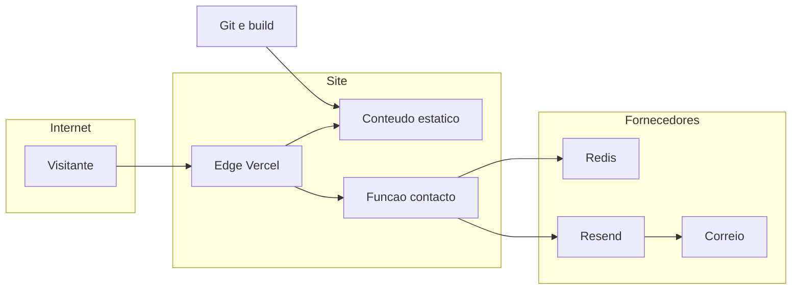

## Executive summary

O site público Dipanda é sobretudo estático; o risco ativo concentra-se no formulário anónimo, serviços de e-mail/limitação, segredos e cadeia de publicação. As correções preparam uma função Vercel com validação, origem exata e quota durável, mas dados legais e infraestrutura real ainda impedem publicação. Um runtime Node antigo foi identificado localmente; o build de produção e a função passam a exigir Node 24.22.1+ da linha 24. Não existe RCE ou exfiltração demonstrada no site.

## Scope and assumptions

Incluídos: `src/`, `public/`, `scripts/`, `api/`, configurações de build/Vercel/Git e dependência npm da raiz. Excluído: `casaspanda/`, por confirmação explícita. Sem testes contra Vercel, Hostinger, Resend, Redis reais ou Queluz Cardoso.

Contexto confirmado pelo utilizador: responsável indicado Paulo Panda, sociedade não constituída; Portugal/UE e Angola; empresas/particulares; sem checkout; nome/e-mail/mensagem; Vercel e domínio Hostinger. Hipóteses validadas em duas perguntas de contexto; país de estabelecimento, morada, NIF, domínio, volume e contratos continuam desconhecidos. A avaliação legal é condicional a esses elementos. Não se presume autenticação, multi-tenancy ou base de dados na Dipanda.

## System model

### Primary components

Build Node gera 20 páginas HTML e copia recursos locais. O navegador executa módulos JavaScript próprios. `/api/contact` usa validação partilhada, quota Redis preparada e envio Resend. O servidor Node local é ferramenta de desenvolvimento/preview; `vercel.json` prepara a produção serverless. Evidência: `scripts/build.mjs`, `scripts/serve.mjs`, `api/contact.js`, `scripts/contact-handler.mjs`.

### Data flows and trust boundaries

- Internet → Vercel/servidor: URL, cabeçalhos e corpo não confiáveis; HTTPS depende de edge real; aplicação valida origem, método, conteúdo, volume e campos. Formulário é anónimo.
- Navegador → armazenamento próprio: consentimento e preferência de animação; cookies validados em `public/js/consent-core.js`, nunca usados como sessão/autorização.
- Função → Upstash: HTTPS autenticado, HMAC de IP/rede e contadores; TTL e script atómico preparados; falha resulta em 503. Não envia mensagem/nome/e-mail ao limitador.
- Função → Resend → caixa de correio: HTTPS e API key, nome/e-mail/mensagem; destino controlado por configuração, sem HTML de visitante. Retenção/acesso/encriptação da caixa dependem da operação real.
- Git/operador → build/conta Vercel: fonte/configuração/segredos; `npm ci --ignore-scripts`, lock e CI preparados. MFA, revisões e branch protection ainda não verificados.

#### Diagram

## Assets and security objectives

| Asset | Why it matters | Security objective (C/I/A) |
|---|---|---|
| Contactos e mensagens | Dados pessoais e informação comercial | C/I |
| Chaves Resend/Redis/HMAC | Envio abusivo, exposição e limites | C/I |
| Conteúdo/build/domínio | Confiança no site e integridade das políticas | I/A |
| Quota/custos e canal de contacto | Disponibilidade para potenciais clientes | A |
| Configuração e escolha de cookies | Privacidade e vontade do visitante | I |

## Attacker model

### Capabilities

Atacante remoto pode enviar pedidos paralelos, cabeçalhos/corpos arbitrários, visitar páginas e seguir ligações; bot consegue forjar Origin, ao contrário de JavaScript de outra origem num navegador. Pode mudar de IP. Dependência, conta de operador ou fornecedor comprometido são ameaças distintas da entrada HTTP pública.

### Non-capabilities

Não se presume acesso a segredos, ao Git, à caixa de correio ou administração Vercel. Não existe utilizador autenticado cujo privilégio possa ser elevado, nem dados entre tenants a explorar no site auditado. Não se presume quebra de TLS ou comprometimento upstream como ocorrência demonstrada.

## Entry points and attack surfaces

| Surface | How reached | Trust boundary | Notes | Evidence (repo path / symbol) |
|---|---|---|---|---|
| Formulário | POST API público | Internet/função | JSON/form-urlencoded, 32 KiB | `scripts/contact-handler.mjs:createContactHandler` |
| URLs e recursos | GET/HEAD | Internet/servidor | Resolução contida em public/dist no servidor local | `scripts/serve.mjs` |
| Cookies | Browser | Armazenamento/JS | Preferências sem privilégio | `public/js/consent-core.js` |
| Env/políticas | Build/administrador | Operador/site | Texto escapado; gate de produção | `scripts/production-readiness.mjs`, `src/policies.mjs` |
| Dependências/CI | npm/GitHub | Upstream/build | Uma dependência dev, sem dependência runtime npm | `package-lock.json`, `.github/workflows/verify.yml` |
| Respostas externas | Resend/Redis | Fornecedor/função | JSON, TLS, redirects recusados, timeout | `scripts/contact.mjs`, `scripts/contact-limits.mjs` |

## Top abuse paths

1. Consumir quota → bot forja origem e envia contactos concorrentes → spam/custos/bloqueio de contactos reais. Origem/honeypot não substituem quotas e WAF.
2. Expor contactos → operador ativa logs de payload ou caixa sem proteção → mensagens acessíveis fora da finalidade.
3. Roubar chave/build → comprometer conta Git/Vercel ou dependência de teste → alteração de conteúdo ou envio abusivo.
4. Executar script → novo conteúdo remoto/CMS inserido em HTML no futuro → XSS. Não foi demonstrado sink de dados de visitante no estado atual.
5. Explorar runtime → aplicação descomprime resposta Brotli de origem comprometida num Node vulnerável → impacto potencial de memória. Entrada comprimida não é aceite pela API; falta confirmar versão gerida real.
6. Recolher dados sem transparência → publicar minutas/identidade incompleta → titulares sem informação adequada e exposição legal.

## Threat model table

| Threat ID | Threat source | Prerequisites | Threat action | Impact | Impacted assets | Existing controls (evidence) | Gaps | Recommended mitigations | Detection ideas | Likelihood | Impact severity | Priority |
|---|---|---|---|---|---|---|---|---|---|---|---|---|
| TM-001 | Bot remoto | Formulário ativo | Pedidos concorrentes/distribuídos | Spam/quota/DoS | Contacto/custos | Reserva e EVAL com TTL (`contact-limits.mjs`), limite de corpo | Redis/WAF reais não testados; global pode bloquear legítimos | Testar Redis/TTL entre instâncias; WAF e alertas | Taxas 429/503 e gasto sem payload | medium | medium | medium |
| TM-002 | Erro operacional/terceiro | Logs/mailbox com acesso excessivo | Reter/divulgar mensagens | Privacidade/confidencialidade | Contactos | Sem logs de corpo na aplicação; JSON/texto apenas | MFA, retenção, DPA e backups desconhecidos | Contratos, acesso mínimo, rotina de eliminação | Auditoria de acessos sem conteúdo | medium | high | high |
| TM-003 | Cadeia/conta comprometida | Privilégio de alteração ou pacote malicioso | Modificar build/extrair segredos | Conteúdo e envio adulterados | Chaves/build | Lock, ignore-scripts, CI com actions fixadas | MFA/proteção de branch não verificados; scanners completos não correram | Revisão, MFA, tokens restritos, SAST em runner compatível | Alertas Git/contas/deployments | low | high | medium |
| TM-004 | Conteúdo hostil futuro | Introdução de CMS/HTML dinâmico | Inserir script ou URL executável | XSS | Visitantes/site | `escape`, textContent, CSP self | HTML permitido só estático; futuras integrações alteram risco | Manter sinks seguros e validar URLs; sanitizador reconhecido se HTML inevitável | Relatórios CSP com retenção adequada | low | high | medium |
| TM-005 | Fornecedor/entrada comprimida hostil | Node antigo e caminho de decompression | Explorar falha Brotli/TLS publicada | Memória/execução possíveis | Chaves/processo | Runtime floor em produção/função; endpoints fixos HTTPS e sem redirects | Runtime local inicial desatualizado; alojamento não inspecionado | Patch de Node; confirmar runtime Vercel; rejeitar compressão de entrada | Inventário de versões/boletins | low | high | medium |
| TM-006 | Publicação prematura | Gate ignorado ou políticas não validadas | Recolher com identificação/texto inexatos | Incumprimento/danos aos titulares | Transparência/contactos | Gate `assertProductionReady`; textos não inventados | País/morada/NIF/contratos/consumo pendentes | Concluir matriz legal com responsável/jurista | Revisão de alterações e aprovação documentada | medium | high | high |

## Criticality calibration

| Level | Critério deste site | Exemplos condicionais, não achados demonstrados |
|---|---|---|
| critical | Compromisso remoto direto amplo com caminho provado | RCE pré-autenticação alcançável; exfiltração pública de todas as mensagens/chaves |
| high | Impacto sério na operação/privacidade ou bloqueio incontornável da publicação | Chave de envio exposta; caixa de contactos pública; recolha pública sem responsável identificado |
| medium | Abuso limitado ou defesa em profundidade incompleta | Quota de contacto contornada; CSP em falta sem XSS demonstrado; configuração externa por verificar |
| low | Informação não sensível/condições improváveis | Versão de servidor exposta; mensagem técnica sem segredo; detalhe de build sem impacto operacional |

## Focus paths for security review

| Path | Why it matters | Related Threat IDs |
|---|---|---|
| `api/contact.js`, `scripts/contact-handler.mjs` | Fronteira pública e fecho de falhas | TM-001, TM-005 |
| `scripts/contact-limits.mjs` | Estado distribuído, IP e TTL | TM-001, TM-002 |
| `scripts/contact.mjs` | PII, remetente/destino e API key | TM-001, TM-002 |
| `scripts/security.mjs`, `vercel.json` | CSP/headers e runtime | TM-004, TM-005 |
| `src/components.mjs`, `src/policies.mjs` | Escape e informação ao titular | TM-004, TM-006 |
| `.github/workflows/verify.yml`, `package-lock.json` | Dependências e permissões | TM-003 |
| `scripts/production-readiness.mjs` | Gate de publicação e configuração | TM-005, TM-006 |

Quality check: entradas e fronteiras acima cobertas; runtime distinguido de build/teste; contexto do utilizador incorporado; dúvidas explícitas; controlos implementados separados dos controlos externos por verificar. Não existe conclusão de segurança absoluta.
